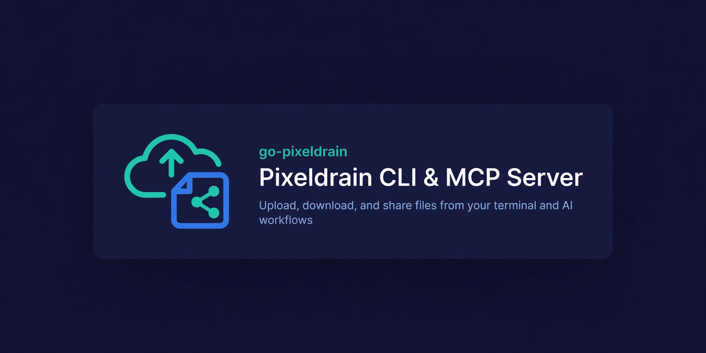

[English](README.md) | 日本語

# pd (Pixeldrain CLI & MCP Server)
[](https://github.com/jkawamoto/go-pixeldrain/actions/workflows/ci.yaml)
[](https://pkg.go.dev/github.com/jkawamoto/go-pixeldrain)
[](LICENSE)
[](https://modelcontextprotocol.io/)

`pd` は、[Pixeldrain](https://pixeldrain.com/) のコマンドラインインターフェース、Model Context Protocol（MCP）サーバー、Go SDK です。

ブラウザを開かずに、ターミナルやシェルスクリプト、AI ワークフローからファイルやアルバムをアップロード、ダウンロード、共有できます。


<div align="center">

<small>ヘッダ画像は Muse（Muse Image）で生成しました。</small>
</div>

## 特徴

- **ファイルやメディアの共有**: コマンドラインからファイルをアップロードし、共有用の Pixeldrain リンクを取得できます。AI 生成画像やスクリーンショット、実行結果をチャットやフォーラムで共有する際に便利です。
- **AI・MCP 連携**: 内蔵の MCP サーバー（`pd mcp`）を通じて、Claude Desktop や Cursor などの AI ツールからファイルをアップロード、ダウンロードできます。
- **アルバム**: `--album` で複数のファイルをまとめ、一つの Pixeldrain アルバム URL を取得できます。
- **エンドツーエンド暗号化**: [age](https://github.com/FiloSottile/age) または SSH の公開鍵を使い、アップロード前にクライアント側でファイルを暗号化できます。
- **Unix パイプラインへの対応**: 標準入力からデータを直接渡したり、`tar` でディレクトリ全体をストリームとして渡したりできます。
- **任意のアカウント連携**: 設定なしで匿名利用できるほか、[Pixeldrain API キー](https://pixeldrain.com/user/api_keys)を使ってファイルをアカウントで管理できます。

## クイックスタート

### ファイルやメディアのアップロード

ファイルを Pixeldrain にアップロードし、ダウンロードリンクを取得します。

```shell
pd upload artwork.png
# => https://pixeldrain.com/u/xxxxxx
```

`path:name` の形式で表示名を指定することもできます。

```shell
pd upload output_0042.png:cyberpunk-city.png
```

### アルバムの作成

複数のファイルを渡すと、一つのアルバムにまとめられます。生成した画像やスクリーンショットをまとめるときに便利です。

```shell
pd upload --album "Neon Dreams" concept1.png concept2.png concept3.png
# => https://pixeldrain.com/l/xxxxxx
```

### ファイルやアルバムのダウンロード

ファイルをローカル環境にダウンロードします。

```shell
# ファイルを一つダウンロード（デフォルトではカレントディレクトリに保存）
pd download https://pixeldrain.com/u/xxxxxx

# 確認プロンプトを表示せず、アルバム内の全ファイルをダウンロード
pd download --all https://pixeldrain.com/l/xxxxxx

# 保存先ディレクトリまたはファイル名を指定
pd download -o ./downloads https://pixeldrain.com/u/xxxxxx
pd download --filename custom.png https://pixeldrain.com/u/xxxxxx
```

## MCP サーバー（AI 連携）

`pd` には [Model Context Protocol（MCP）](https://modelcontextprotocol.io/) サーバーが組み込まれており、AI エージェントからテキストや画像、ファイルを Pixeldrain に直接アップロードできます。

次のコマンドでサーバーを起動します。

```shell
pd mcp
```

### 設定（Claude Desktop / Cursor）

MCP の設定ファイル（`claude_desktop_config.json` など）に `pixeldrain` を追加します。

```json
{
  "mcpServers": {
    "pixeldrain": {
      "command": "pd",
      "args": ["mcp"],
      "env": {
        "PIXELDRAIN_API_KEY": "your_api_key_here"
      }
    }
  }
}
```

> [!NOTE]
> `PIXELDRAIN_API_KEY` の設定は任意です。設定すると、AI エージェントがアップロードしたファイルは指定した Pixeldrain アカウントに紐づきます。

### 利用できる MCP ツール

- `upload_files`: 一つ以上のファイル（画像、音声、アーカイブ）をアップロードし、ファイルまたはアルバムの URL を返します。各ファイルは `{name, data}` で指定し、`data` にはローカルファイルのパス、Base64、または Base64 データ URI を使用できます。
- `list_recipients`: 暗号化アップロード用に設定された公開鍵 ID を一覧表示します。`--age-recipients-dir` または `--ssh-recipients-dir`、あるいは両方を指定してサーバーを起動します。各ディレクトリには、一つの `.pub` ファイルにつき一つの公開鍵を置きます。選択した ID は、`upload_text` または `upload_files` の `recipients` に渡します。
- `pd mcp --identity-file /path/to/key` でサーバーを起動すると、ローカルの age 秘密鍵または暗号化されていない SSH 秘密鍵を使って、ダウンロードした `.age` ファイルを復号できます。MCP は SSH 鍵のパスフレーズを入力するプロンプトを表示しません。
- `upload_text`: プレーンテキストまたは Markdown をファイルとしてアップロードし、ダウンロード URL を返します。
- `download_file`: Pixeldrain からローカルマシンにファイルをダウンロードします。

## 応用的な使い方

### 標準入力からのアップロード（ログ、差分、パイプライン）

パスに `-` を指定すると、標準入力からデータをアップロードできます。`-` がフラグとして扱われないよう、手前に `--` を指定します。

```shell
# コマンドの出力やログをアップロード
cat build.log | pd upload -- -:build.log

# Git の差分をアップロード
git diff | pd upload -- -:patch.diff
```

### ディレクトリのアップロード

ディスクに一時ファイルを作成せず、ディレクトリのアーカイブをストリームとして直接アップロードします。

```shell
tar zcf - ~/Projects/my-app | pd upload -- -:my-app.tar.gz
```

### エンドツーエンド暗号化（E2EE）

[age](https://github.com/FiloSottile/age) または SSH の公開鍵を使い、アップロード前にローカルでファイルを暗号化します。

```shell
# age の公開鍵または SSH 鍵で暗号化
pd upload --recipient "age1..." secret.pdf
pd upload --recipient "ssh-ed25519 AAAA..." secret.pdf

# ファイルを使って複数の受信者向けに暗号化
pd upload --recipient-file recipients.txt secret.pdf
```

アップロードされるファイルには、自動的に `.age` 拡張子が付きます。

ダウンロード時に復号するには、`--identity` で秘密鍵を指定します。

```shell
pd download --identity ~/.ssh/id_ed25519 https://pixeldrain.com/u/xxxxxx
```

### アカウント認証

アップロードしたファイルを Pixeldrain アカウントに紐づけるには、`--api-key` フラグまたは `PIXELDRAIN_API_KEY` 環境変数で API キーを指定します。

```shell
export PIXELDRAIN_API_KEY="your-api-key"
pd upload file.zip

# またはコマンドのフラグで指定
pd --api-key "your-api-key" upload file.zip
```

API キーは [pixeldrain.com/user/api_keys](https://pixeldrain.com/user/api_keys) で生成できます。

## インストール

### Homebrew（macOS・Linux）

```shell
brew tap jkawamoto/pixeldrain
brew install pixeldrain
```

### Go Install

```shell
go install github.com/jkawamoto/go-pixeldrain/cmd/pd@latest
```

### ビルド済みバイナリ

macOS、Linux、Windows 向けのビルド済みバイナリを [GitHub Releases](https://github.com/jkawamoto/go-pixeldrain/releases) で公開しています。

## Go ライブラリの使い方

`go-pixeldrain` は、[Pixeldrain REST API](https://pixeldrain.com/api) の Go クライアントライブラリも提供しています。

API リファレンスと使用例は、[pkg.go.dev](https://pkg.go.dev/github.com/jkawamoto/go-pixeldrain) のパッケージドキュメントを参照してください。

## ライセンス

このソフトウェアは [MIT License](LICENSE) の下で公開されています。
