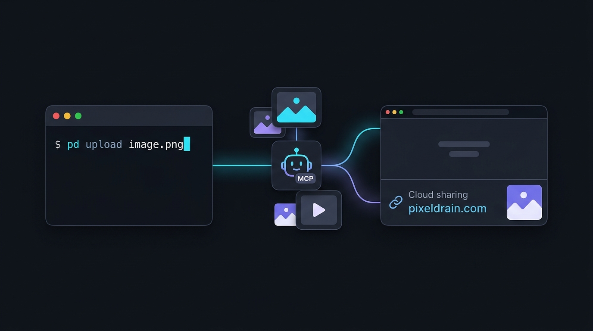

# pd (Pixeldrain CLI & MCP Server)
[](https://github.com/jkawamoto/go-pixeldrain/actions/workflows/ci.yaml)
[](https://pkg.go.dev/github.com/jkawamoto/go-pixeldrain)
[](LICENSE)
[](https://modelcontextprotocol.io/)

`pd` is a command-line interface, Model Context Protocol (MCP) server, and Go SDK for [Pixeldrain](https://pixeldrain.com/).

It provides an easy way to upload, download, and share files or albums directly from your terminal, shell scripts, and AI workflows without needing to open a browser.

<div align="center">

</div>

## Features

- **Quick File & Media Sharing**: Upload files from the command line and get a shareable Pixeldrain link instantly. Convenient for sharing AI-generated images, screenshots, or outputs in chats and forums.
- **AI & MCP Integration**: Built-in MCP server (`pd mcp`) that lets AI tools (such as Claude Desktop and Cursor) upload and download files on your behalf.
- **Album Support**: Combine multiple files into a single Pixeldrain album URL with `--album`.
- **End-to-End Encryption**: Encrypt files client-side using [age](https://github.com/FiloSottile/age) or SSH public keys before uploading.
- **Unix Pipeline Friendly**: Pipe data directly from `stdin` or stream entire directories with `tar`.
- **Optional Account Binding**: Works anonymously out of the box, or with your [Pixeldrain API key](https://pixeldrain.com/user/api_keys) to keep files organized in your account.

## Quick Start

### Upload Files & Media

Upload any file to Pixeldrain and receive a download link:

```shell
pd upload artwork.png
# => https://pixeldrain.com/u/xxxxxx
```

You can optionally specify a custom display name using the `path:name` syntax:

```shell
pd upload output_0042.png:cyberpunk-city.png
```

### Create Albums

Pass multiple files to group them into a single album. This is especially handy for collections of generated images or screenshots:

```shell
pd upload --album "Neon Dreams" concept1.png concept2.png concept3.png
# => https://pixeldrain.com/l/xxxxxx
```

### Download Files & Albums

Download files back to your local environment:

```shell
# Download a single file (saved to current directory by default)
pd download https://pixeldrain.com/u/xxxxxx

# Download all files from an album without interactive prompts
pd download --all https://pixeldrain.com/l/xxxxxx

# Specify destination directory or filename
pd download -o ./downloads https://pixeldrain.com/u/xxxxxx
pd download --filename custom.png https://pixeldrain.com/u/xxxxxx
```

## MCP Server (AI Integration)

`pd` includes a built-in [Model Context Protocol (MCP)](https://modelcontextprotocol.io/) server, allowing AI agents to upload text, images, and files directly to Pixeldrain.

Start the server via:

```shell
pd mcp
```

### Configuration (Claude Desktop / Cursor)

Add `pixeldrain` to your MCP configuration (e.g. `claude_desktop_config.json`):

```json
{
  "mcpServers": {
    "pixeldrain": {
      "command": "pd",
      "args": ["mcp"],
      "env": {
        "PIXELDRAIN_API_KEY": "your_api_key_here"
      }
    }
  }
}
```

> [!NOTE]
> Setting `PIXELDRAIN_API_KEY` is optional. If configured, files uploaded by the AI agent will belong to your Pixeldrain account.

### Available MCP Tools:
- `upload_files`: Upload one or more base64-encoded files (images, audio, archives) and return a file or album URL.
- `upload_text`: Upload plain text or markdown as a file and return a download URL.
- `download_file`: Download a file from Pixeldrain to the local machine.

## Advanced Usage

### Upload from STDIN (Logs, Diffs, Pipelines)

Pass `-` as the path to upload data from standard input (prepend `--` to ensure `-` is not treated as a flag):

```shell
# Upload command output or logs
cat build.log | pd upload -- -:build.log

# Upload a git diff
git diff | pd upload -- -:patch.diff
```

### Upload a Directory

Stream and upload a directory archive directly without creating temporary files on disk:

```shell
tar zcf - ~/Projects/my-app | pd upload -- -:my-app.tar.gz
```

### End-to-End Encryption (E2EE)

Encrypt files locally before uploading with [age](https://github.com/FiloSottile/age) or SSH public keys:

```shell
# Encrypt with an age public key or SSH key
pd upload --recipient "age1..." secret.pdf
pd upload --recipient "ssh-ed25519 AAAA..." secret.pdf

# Encrypt for multiple recipients using a file
pd upload --recipient-file recipients.txt secret.pdf
```
*(Uploaded files will automatically have the `.age` extension).*

To decrypt upon download, provide your private key with `--identity`:

```shell
pd download --identity ~/.ssh/id_ed25519 https://pixeldrain.com/u/xxxxxx
```

### Account Authentication

To associate uploads with your Pixeldrain account, provide your API key via the `--api-key` flag or the `PIXELDRAIN_API_KEY` environment variable:

```shell
export PIXELDRAIN_API_KEY="your-api-key"
pd upload file.zip

# Or via command flag:
pd --api-key "your-api-key" upload file.zip
```
API keys can be generated at [pixeldrain.com/user/api_keys](https://pixeldrain.com/user/api_keys).

## Installation

### Homebrew (macOS & Linux)

```shell
brew tap jkawamoto/pixeldrain
brew install pixeldrain
```

### Go Install

```shell
go install github.com/jkawamoto/go-pixeldrain/cmd/pd@latest
```

### Pre-built Binaries

Pre-compiled binaries for macOS, Linux, and Windows are available on [GitHub Releases](https://github.com/jkawamoto/go-pixeldrain/releases).

## Go Library Usage

`go-pixeldrain` also provides a Go client library for the [Pixeldrain REST API](https://pixeldrain.com/api).

See the package documentation on [pkg.go.dev](https://pkg.go.dev/github.com/jkawamoto/go-pixeldrain) for API reference and usage examples.

## License

This software is released under the [MIT License](LICENSE).
